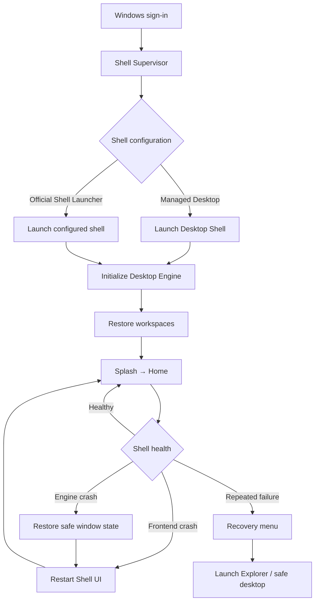
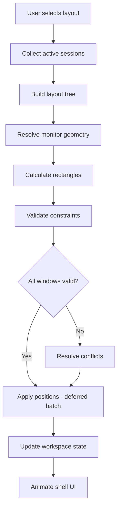

# MASTER PLAN: Windows Desktop Environment

> **Codename:** `{{PRODUCT_NAME}}` (branding undecided)
> **Doc version:** 0.1, 2026-11-19
> **Status:** Pre-implementation. Everything below is a plan, not a measurement.
> **Stack:** Rust · Tauri 2 · React 19 · TypeScript · SQLite · Win32/DWM/COM/WinRT
> **Platform:** Windows 11 primary, Windows 10 best-effort. Some features depend on Windows edition/version.

This document merges the original idea, the three architecture drafts, and the later design additions (PS5-style Home, Dynamic Island, floating dock, native File Manager, unified Settings). Where the drafts disagreed, Appendix D records what was chosen and why.

**Sections that matter most:**

| If you want… | Read |
|---|---|
| What we're building | §1, §2 |
| What Windows will and won't let us do | §3 |
| How it's built | §4 – §9 |
| What the user sees | §10 – §14 |
| Look and feel | §16 |
| In what order | §22 |
| What could kill the project | §23 |

---

## 0. Table of contents

1. Vision and product definition
2. Decisions: locked and open
3. Windows reality check (constraints that shape everything)
4. System architecture
5. Window engine
6. Application sessions
7. Layout engine
8. Multi-monitor
9. Workspaces
10. Multitasking experience (switchers, split-screen, gestures)
11. Shell experience (Home, Island, Dock, Library, Search, Quick Settings, Notifications, Widgets, Splash)
12. Native system apps and Windows integration (File Manager, Settings, system services)
13. Gaming experience
14. Input system
15. Context-aware environment
16. Design system: Adaptive Glass
17. Data and storage
18. Plugins and automation
19. Performance
20. Security and reliability
21. Testing strategy
22. Roadmap
23. Risk register
24. Requirements index
25. Long-term backlog
26. Open questions
- Appendix A: Glossary
- Appendix B: Prototype acceptance tests and compatibility matrix
- Appendix C: Pre-milestone technical spikes
- Appendix D: Source reconciliation notes

---

## 1. Vision and product definition

### 1.1 One-line definition

A customizable, high-performance desktop environment for Windows that unifies applications, games, workspaces, displays, files and system controls into one seamless, mobile-simple, console-polished experience.

### 1.2 What it is (and isn't)

| It **is** | It is **not** |
|---|---|
| A native Windows shell and window-management platform | An operating system |
| A layer on top of real Windows apps | A VM, emulator, or compatibility layer |
| A launcher, switcher, dock, and workspace manager in one | Just a launcher that happens to have split-screen |
| A unified interface for Windows system functions | A rewrite of every Windows feature |
| Outside-in: it manages windows from outside the app's process | Something that injects into games/apps or touches their memory |

Real applications stay real Windows applications. Their windows stay native and independently managed. **We do not embed external apps inside the Tauri webview.**

### 1.3 Origin and motivation

The desktop is messy and full. The goal is one place to launch everything, switch easily like a phone, split-screen across multiple monitors, boot straight into it like SteamOS, and have it all feel like one modern OS.

### 1.4 Design pillars

1. **One environment, everything accessible.** Apps, games, files, workspaces, and settings live in one place.
2. **Multitasking without friction.** Fullscreen apps, floating windows, split-screen, and workspaces without fighting Windows.
3. **Everything is customizable.** Appearance, layout, behavior, shortcuts, animation, wallpapers, input methods.
4. **Gaming and productivity are equal.** It shouldn't feel like a gaming launcher during office work, or like a plain desktop while gaming.
5. **Native performance.** Rust owns OS integration. React owns the interface. Win32 owns window management. A beautiful shell that stutters on a mid-range GPU has failed.
6. **Recoverable by design.** The user can never lose access to Windows because our shell failed.
7. **Controller-first from day one.** Mouse/keyboard and gamepad are both first-class. Don't retrofit.

### 1.5 Visual identity (summary)

A synthesis, not a pastiche:

| Source of inspiration | What we take |
|---|---|
| PS5 | Cinematic Home, large app cards, horizontal carousels, artwork-driven backgrounds |
| macOS | Floating dock, magnification, refined interaction details |
| Dynamic Island | Adaptive top-center system surface with live activities |
| SteamOS / Big Picture | Controller-first navigation, console-style boot, game library |
| visionOS / Liquid Glass | Glass materials, depth, spatial transitions |
| Windows | Native compatibility and system functionality underneath |

The end result must have its own identity, not five interfaces stitched together.

### 1.6 Product modes

Three presentation configurations over **the same engine**. Switching modes never restarts applications.

| Mode | What it is |
|---|---|
| **Home Mode** (default) | Dashboard, library, widgets, search, notifications, workspace navigation |
| **Gaming Mode** | Controller-first navigation, game library, fullscreen games, overlays, performance monitoring, Big Picture typography |
| **Desktop Mode** | Floating windows, tiling, multi-monitor management, advanced multitasking |

### 1.7 Target users

- **Primary:** the builder (hybrid gamer/developer/creator, multi-monitor).
- **Secondary:** PC gamers wanting a console-like experience, handheld/HTPC users, power users who like tiling WMs (komorebi/GlazeWM) but want polish.
- **Not a target (initially):** locked-down enterprise deployments, non-Windows platforms.

### 1.8 Non-goals (v1)

- No cross-platform support.
- No app embedding/reparenting into the webview.
- No injection into games or processes.
- No exclusive-fullscreen tiling promises.
- No default elevation.
- No silent registry tweaks to make settings "look integrated."
- No cloud account or telemetry requirement.

---

## 2. Decisions: locked and open

### 2.1 Locked

| # | Decision | Direction |
|---|---|---|
| D1 | Audience | **Hybrid:** gaming + productivity |
| D2 | Windows integration | **Both:** managed companion first, full shell replacement later (optional, recoverable) |
| D3 | Multitasking | **Both:** mobile-style (fullscreen apps, switcher) and desktop-style (floating + tiled) |
| D4 | Stack | Tauri 2 + React 19 + TypeScript + Rust (`windows-rs`) |
| D5 | Look | Liquid-glass design language by default; PS5-style Home |
| D6 | Always-present surfaces | Dynamic Island, floating dock, Home |
| D7 | Architecture rule | Native window engine is independent of the UI and built first |
| D8 | Window strategy | Windows stay native top-level windows; we manage them from outside |
| D9 | Startup | Auto-launches with Windows, animated splash, then Home |
| D10 | System features | Own File Manager and Settings; fall back to Windows when no reliable API exists |

### 2.2 Open (see §26)

Product name and branding, installer/distribution channel, license/open-source stance, minimum Windows version, whether assistant features are in scope, and where thumbnails will be rendered (spike, Appendix C).

---

## 3. Windows reality check

These constraints shape every later section. Items marked **(spike)** must be proven early (Appendix C).

### 3.1 We can't truly embed other apps

`SetParent` into a webview breaks input, DPI, GPU rendering, and UWP/Electron apps. The model is:

> Spawn/adopt a real top-level window → record its original state → strip supported decorations → position it over a region the shell owns → manage z-order and focus.

This is how tiling window managers on Windows work. The React UI is the backdrop and overlay layer; apps sit above the backdrop, below overlays when summoned.

### 3.2 Facts that must be designed around

| Reality | Consequence |
|---|---|
| One app ≠ one process ≠ one window | Separate Application / Process / Window entities (§5.1) |
| Launchers spawn other processes (Steam games, Chrome, Battle.net, Epic) | We "adopt" windows we didn't directly spawn; process-tree and heuristic matching |
| UWP/packaged apps (e.g. modern Calculator) are hosted by `ApplicationFrameHost` | Window→app mapping needs special handling; filter cloaked/ghost windows (DWM cloak attribute) |
| `SetForegroundWindow` can be refused | Focus needs fallbacks; never assume success |
| Exclusive fullscreen can't be tiled | Compatibility profiles; borderless/windowed supported, exclusive fullscreen never promised |
| Some apps recreate their HWND, refuse resize, or enforce min sizes | Compatibility layer + per-app profiles + constraint-aware layout |
| Elevated (admin) windows can't be managed from a non-elevated process (UIPI) | Shell runs non-elevated; optional elevated helper later |
| UAC secure desktop and lock screen are untouchable | Overlays hidden there; never promised |
| HWNDs can go invalid and be reused; PIDs can be reused | Validate identity before destructive operations (§20) |
| Win-key combos (Win+Space, Win+Tab, Win+A, Win+Q, Win+G, Win+D) are largely owned by Explorer/Windows | Defaults must not depend on them in Managed mode (§14.3) **(spike)** |
| Alt+Tab replacement can't use a plain global hotkey | Needs a low-level keyboard hook design **(spike)** |
| WebView2 can't sample the desktop behind it | No true refraction of arbitrary desktop content; we render our own wallpaper (§16.3) |
| DWM thumbnails render into a native destination HWND, not into a DOM | Switcher thumbnails need a native thumbnail layer or capture-based alternative **(spike)** |
| Windows Shell Launcher is edition-limited (Enterprise/Education/IoT Enterprise) | Three deployment modes (§4.5) |
| Not every Windows setting has a public API | Native where supported, `ms-settings:` fallback otherwise (§12.3) |
| Reading other apps' notifications is restricted | Notification center scope needs a spike; may require package identity **(spike)** |

### 3.3 Hard rules

1. Never inject into, hook, or modify the memory of apps or games.
2. Never rely on constant topmost for shell windows.
3. Never replace Explorer without a tested escape hatch.
4. Never trust a stored HWND after a reboot, or even after a long idle.
5. Never remove every window style indiscriminately. Test borderless per app.

---

## 4. System architecture

### 4.1 Layers

```text
┌──────────────────────────────────────────────────────────────┐
│ DESKTOP SHELL (React 19 + TS in WebView2)                     │
│ Home · Gaming · Desktop · Dock · Island · Switcher · Settings │
└──────────────────────────────┬───────────────────────────────┘
                 typed commands / events (versioned protocol)
┌──────────────────────────────┴───────────────────────────────┐
│ TAURI APPLICATION HOST (Tauri 2)                              │
│ Command API · Event bridge · Native window coordination       │
└──────────────────────────────┬───────────────────────────────┘
┌──────────────────────────────┴───────────────────────────────┐
│ RUST DESKTOP ENGINE (UI-independent)                          │
│ Window Mgr · Process Mgr · Session Mgr · Workspace Engine     │
│ Layout Engine · Display Mgr · Input Mgr · App Library         │
│ Theme Engine · Automation Engine · Plugin Host · Persistence  │
└──────────────────────────────┬───────────────────────────────┘
┌──────────────────────────────┴───────────────────────────────┐
│ WINDOWS PLATFORM: Win32 · DWM · COM · WinRT · Shell · Display │
└──────────────────────────────┬───────────────────────────────┘
┌──────────────────────────────┴───────────────────────────────┐
│ REAL WINDOWS APPLICATIONS: games, browsers, editors, UWP, … │
└──────────────────────────────────────────────────────────────┘
```

**Rules:**

- The frontend never touches Win32. It sends intents ("move Spotify to workspace Music"); Rust performs and reports.
- Tauri commands are the **API boundary**, not where business logic lives.
- The engine must be independent enough to run with the UI crashed or reloaded; managed apps must stay usable.
- All state changes are observable through engine events.

Example flow:

```text
React: "Move Spotify to workspace Music"
  → Tauri command: move_window_to_workspace(window_id, workspace_id)
  → Engine: validate HWND → update placement → update workspace state → emit event
  → React: animate workspace transition
```

### 4.2 Process model

| Process | Responsibility |
|---|---|
| `ShellSupervisor.exe` | Startup, health monitoring, crash recovery, emergency Explorer fallback |
| `DesktopEngine.exe` | Window management, sessions, workspaces, native APIs |
| `DesktopShell.exe` | Tauri + React UI |

**Phasing:** start with Engine + Shell in one process (Tauri's Rust backend) but write the interfaces as if they were separate. Split when mature for crash isolation. The supervisor should be independent from day one of shell-replacement work (M07), and must never kill unrelated user apps during recovery.

### 4.3 Shell supervisor

A small, dependency-light native process:

- Starts the shell, monitors health (heartbeat), detects crashes, restarts it.
- Restores safe window state after engine crashes.
- Escalates to the Recovery Menu after repeated failures.
- Offers a path back to Explorer / safe desktop.
- Reads recovery configuration from a location independent of the main database.

### 4.4 Boot and recovery flow



### 4.5 Deployment configurations

| Mode | For | What happens |
|---|---|---|
| **Managed Desktop** (default, build first) | Any Windows install | Explorer keeps running. Our shell autostarts (Task Scheduler/Run entry), runs fullscreen, provides Home/dock/switcher. Hiding the Windows taskbar is an **optional** toggle. |
| **Official Shell Launcher** | Enterprise / Education / IoT Enterprise | Configure our app as the shell via Microsoft's supported feature. Recovery behavior configured; Explorer restorable. |
| **Custom Shell Mode** (advanced/experimental) | Advanced users | Alternate shell-startup mechanisms (e.g. per-user shell override). Explicit warnings, explicit confirmation, recovery access required. **Never the default install path.** |

Shell configuration is its own module (`shell-manager`), not mixed into the window manager. Architect for all three; implement only Managed Desktop initially. Do not replace Explorer during early development: you want to crash the app without losing the desktop.

### 4.6 Emergency recovery (non-negotiable)

- Global emergency shortcut.
- Supervisor-owned recovery screen (not dependent on WebView).
- "Restart Explorer" and "Disable shell startup" actions.
- Safe-mode launch option.
- Last-known-good configuration fallback.
- Recovery config stored outside the main database.
- Shell replacement is never irreversible.
- If the Windows taskbar was hidden, the supervisor restores it on any exit path.

### 4.7 Technology stack

| Layer | Technology |
|---|---|
| Desktop runtime | Tauri 2 |
| Frontend | React 19 + TypeScript |
| Styling | Tailwind CSS + custom design tokens |
| Components | Custom component library |
| Animation | Motion (formerly Framer Motion) |
| Advanced graphics | WebGL / Three.js (targeted effects only) |
| Backend | Rust |
| Windows integration | `windows-rs` |
| Async | Tokio |
| Database | SQLite via SQLx |
| Serialization | Serde |
| Logging | `tracing` |
| Config | TOML / JSON |
| Controller | `gilrs` / XInput / Windows.Gaming.Input |
| Window vibrancy | `window-vibrancy` (Mica/Acrylic) |
| Installer | WiX / NSIS |
| Testing | `cargo test` + Playwright |
| Package mgmt | Cargo workspace + pnpm workspace |

Alternatives considered (Dioxus, Slint, Iced, egui, WinUI 3 + Rust): none remove the hard part (Windows window management), and Tauri + React best serves an elaborate web-style visual design. Stay with Tauri.

Windows technologies:

| Tech | Responsibility |
|---|---|
| User32 | Windows, input, positioning, focus |
| DWM | Composition, thumbnails, cloak/attributes |
| WinEvent hooks | Window lifecycle observation |
| Shell APIs / COM | App discovery, launching, file ops, namespace |
| Display APIs | Monitor config and detection |
| WinRT | Media sessions, radios, Bluetooth, modern integrations |
| Core Audio | Volume / devices |
| Registry | Startup + shell configuration (guarded) |
| Task Scheduler | Startup and recovery integration |

### 4.8 Window topology (what native windows exist)

Reconciling the drafts: per monitor there are **two** Tauri/WebView windows plus one global.

| Window | Count | Purpose | Z-order policy |
|---|---|---|---|
| **Shell surface** | 1 per monitor | Wallpaper, Home, per-monitor workspace backdrop | Bottom; managed apps sit above it |
| **Overlay** | 1 per monitor (transparent) | Island, dock, notifications, switcher, quick settings | Raised on demand, not permanently topmost; non-activating where possible |
| **Main/control window** | 1 | Settings, File Manager, library views, developer tools | Normal window |
| **Recovery UI** | 1, supervisor-owned | Emergency menu | Independent of WebView |

Within an overlay's WebView, React renders many independent components (Island, Dock, Toasts, Switcher). Do **not** create one native window per small visual element.

### 4.9 Repository structure

```text
desktop-environment/
├── apps/
│   ├── shell-ui/                      # React + TS
│   │   └── src/
│   │       ├── app/ (ShellApp, Router, Provider)
│   │       ├── shell/ (HomeShell, DesktopShell, GamingShell, OverlayShell)
│   │       ├── components/ (DynamicIsland, FloatingDock, NotificationCenter,
│   │       │                ApplicationSwitcher, QuickSettings, WorkspaceSwitcher,
│   │       │                CommandPalette)
│   │       ├── features/ (home, library, games, file-manager, settings,
│   │       │              workspaces, multitasking, system-monitor,
│   │       │              personalization, widgets)
│   │       ├── design-system/ (materials, components, typography, colors,
│   │       │                   spacing, motion)
│   │       ├── services/ (windows, applications, filesystem, displays, system)
│   │       ├── stores/ (app, workspace, overlay, display, settings)
│   │       ├── hooks/  themes/  animations/  styles/
│   └── developer-tools/               # Window-management debugger UI
├── src-tauri/                         # Tauri host: main.rs, app.rs, commands/, events/, bridge/
├── crates/
│   ├── desktop-core/                  # shared types, IDs, errors
│   ├── desktop-protocol/              # versioned command/event schema (typed bindings → TS)
│   ├── platform-windows/              # ALL unsafe Win32/COM lives here
│   ├── window-manager/                # owns native HWND operations
│   ├── process-manager/               # process lifecycle + tree tracking
│   ├── session-manager/
│   ├── workspace-manager/             # owns workspace state
│   ├── layout-engine/                 # pure geometry, no Win32
│   ├── display-manager/               # owns monitor discovery/config
│   ├── application-library/
│   ├── library-providers/             # steam, epic, gog, xbox, start-menu, uwp
│   ├── input-manager/  hotkey-manager/
│   ├── thumbnail-engine/
│   ├── overlay-manager/               # Island, dock, notifications, z-order coordination
│   ├── system-integration/            # file manager, settings, audio, display, network
│   ├── shell-manager/                 # startup, shell modes, Explorer interop
│   ├── shell-supervisor/
│   ├── settings-manager/  theme-engine/  motion-engine-assets/
│   ├── automation-engine/  plugin-host/
│   ├── performance-monitor/
│   └── persistence/
├── resources/ (icons, wallpapers, sounds, shaders, fonts, animations)
├── tests/ (integration, window-management, layouts, recovery)
├── docs/ (PRODUCT, ARCHITECTURE, WINDOW_ENGINE, WORKSPACES, MULTI_MONITOR,
│          SHELL_REPLACEMENT, DESIGN_SYSTEM, SECURITY, ROADMAP)
├── Cargo.toml · pnpm-workspace.yaml · README.md
```

Don't build every crate up front. Establish the boundaries, then extract crates as responsibilities become real.

**Ownership rules:**

- `window-manager` owns native HWND operations.
- `workspace-manager` owns workspace state.
- `layout-engine` calculates rectangles only; never touches windows.
- `process-manager` owns process lifecycle.
- `display-manager` owns monitor discovery.
- `overlay-manager` owns visibility/placement of every floating shell surface.
- `platform-windows` is the only crate with `unsafe` Win32 glue; everything else uses safe wrappers (newtype HWND, validated handles).
- The frontend never calls Win32.

---

## 5. Window engine (the heart of the project)

### 5.1 Entities

Never assume one app = one PID = one HWND.

```rust
struct Application   { id, app_key, display_name, executable_path, launch_config }
struct ProcessInstance { pid, parent_pid: Option<u32>, application_id, started_at } // identity must survive PID reuse
struct ManagedWindow {
    id, hwnd /* wrapped, validated */, pid,
    title, window_role: WindowRole,
    workspace_id: Option<_>, monitor_id: Option<_>,
    state: WindowState, placement: WindowPlacement,
    original_styles: WindowStyles,
}
enum WindowState { Discovered, Managed, Focused, Hidden, Minimized, Unmanaged, Destroyed }
enum WindowRole  { Main, Dialog, Tool, Popup, Unknown }
```

These are conceptual. Production code wraps handles in types, validates lifecycle, and accounts for PID reuse.

### 5.2 Discovery

Event-driven with periodic reconciliation (no 100 ms polling):

- `EnumWindows` for initial enumeration.
- `SetWinEventHook` for lifecycle: created, destroyed, shown, hidden, foreground changed, location changed, name changed, minimize start/end.
- Process creation tracking and process-tree inspection.
- Periodic reconciliation as a safety net.
- Filtering: ignore tool/ghost/cloaked windows, shell windows, our own windows, zero-size and invisible windows.
- **Window adoption:** windows not spawned by us (e.g. games launched by Steam) are matched by process tree, executable path, window class/title heuristics, and the launch timeout window, then attached to the right session.

### 5.3 Operations

Stable internal API (async, never on the UI thread):

```rust
trait WindowController {
    fn discover_windows(&self);
    fn focus_window(&self, id);   fn hide_window(&self, id);   fn show_window(&self, id);
    fn minimize_window(&self, id); fn restore_window(&self, id);
    fn move_window(&self, id, bounds: Rect);
    fn set_borderless(&self, id, enabled: bool);
    fn assign_workspace(&self, id, ws); fn assign_monitor(&self, id, mon);
}
```

Use `SetWindowPos`, and `BeginDeferWindowPos`/`DeferWindowPos`/`EndDeferWindowPos` for coordinated multi-window layout changes.

### 5.4 Window modes

| Mode | Behavior |
|---|---|
| **Windowed** | App behaves normally; tracked but undecorated/untouched |
| **Managed fullscreen** | Supported borders removed; app maximized into a monitor or workspace region |
| **Tiled** | Several windows share the screen per layout |

Never force every app into borderless. Games and some apps have unusual styles, minimum sizes, or exclusive fullscreen.

### 5.5 Restoration (mandatory)

Before modifying any window, save: style, extended style, rectangle, maximized/minimized state, monitor, relevant z-order. Restore on leaving managed mode, on session close, and during crash recovery. Persist originals so a crash doesn't strand windows without borders. Borderless conversion is tested per application, not applied blindly.

### 5.6 Focus and activation

Switch flow: resolve session → pick the window → show/restore → apply workspace visibility policy → foreground (with fallbacks) → update active session → notify frontend to animate.

`SetForegroundWindow` may be refused, so implement ordered fallbacks (thread input attach, minimize/restore nudge, alt-key trick, etc.), measure which work, and surface a non-fatal state when focus can't be taken.

### 5.7 Fullscreen stacking and overlay policy (prototype first)

Scenario: game fullscreen → user summons switcher → switcher must appear **above** the game → user picks Discord → game and Discord rearrange.

- Do not make every shell window permanently topmost.
- Overlay windows are raised only while active, and are non-activating when they should not steal input (compact Island, hover dock).
- Hit-testing is controlled so a visual-only animation never steals focus.
- Behavior matrix:

| Situation | Overlay behavior |
|---|---|
| Normal desktop | Dock + Island visible |
| Home screen | Integrated into Home layout |
| Regular app fullscreen | Reveal on interaction / edge |
| Managed borderless game | Optional gaming overlay |
| Exclusive fullscreen | No overlay promised |
| UAC secure desktop | Hidden |
| Lock screen | Hidden |

### 5.8 Background policy

Per app/session, three user-facing policies:

| Policy | Meaning |
|---|---|
| **Keep running** | Normal background operation (default) |
| **Hide** | Remove from the visible workspace; process untouched |
| **Minimize** | Standard Windows minimize |

Process **suspension** is a separate, opt-in, per-app optimization (never default). It would use undocumented/limited APIs and games, browsers, music, and apps with background tasks behave very differently. "Hide" itself must be validated per app (some misbehave when hidden).

### 5.9 Close semantics

Three separate operations: normal window close, app-specific exit, force terminate. Closing a window never silently kills a whole process tree.

### 5.10 Developer window debugger (build in M01)

A dev-only "window lab" showing every discovered HWND with PID/exe, parent/owner, styles/ex-styles, rectangle, monitor, workspace, focus, visibility, lifecycle. Actions on a selected window: remove/restore borders, resize, move, hide/show, focus, assign workspace. When something fails you must know whether it was discovery, HWND selection, styles, focus, or layout math.

---

## 6. Application sessions

A **session** is the user's interaction with an app, not a process or a window.

```text
Session: Spotify · 2 processes · 1 main window
State: Background · Workspace: Entertainment · Monitor: Display 2 · Window mode: Normal
```

| State | Meaning |
|---|---|
| Launching | Process starting; window hunt in progress (with timeout) |
| Active | Visible and usable |
| Focused | Receiving foreground input |
| Background | Running, not visible |
| Minimized | Minimized through Windows |
| Suspended | Opt-in, where supported |
| Terminating | Being closed |
| Closed | Gone |

A session can hold multiple windows (popups, project windows). Switcher, dock, search, library, and workspace cards all call the **same launch API**; there is one way to start an app.

Lifecycle: launch request → process start & tracking → window discovery/adoption → record original styles, apply mode, position → register session (Recents, dock, workspace) → switching manages focus/visibility.

---

## 7. Layout engine

A separate pure-Rust crate: **calculates geometry only**, so layouts are unit-testable without launching apps.

### 7.1 Layout types

Fullscreen · Split · Grid · Columns · Rows · Floating · Picture-in-picture · Custom (user-made).

Presets: 50/50, 70/30, 30/70, vertical/horizontal splits, three-column, 50/25/25, four quadrants, picture-in-picture, fullscreen focus.

### 7.2 Recursive layout tree

```rust
enum LayoutNode {
    Split { direction: SplitDirection, ratio: f32, first: Box<LayoutNode>, second: Box<LayoutNode> },
    Window { session_id: String },
    Empty,
}
```

```text
Root
└── Horizontal split (50%)
    ├── Game
    └── Vertical split (50%)
        ├── Discord
        └── Browser
```

Arbitrary arrangements without a bespoke algorithm per preset.

### 7.3 Constraints

Monitor working area · DPI scaling · minimum window sizes · per-app sizing constraints · reserved dock space · display safe areas · window margins · user spacing.

Use **physical pixels** internally for Win32 placement; store user-facing geometry as normalized/logical units. Support **previewing** a layout before committing.

### 7.4 Transition pipeline



### 7.5 Split-screen editor

Drag a card from the switcher into a slot; drag dividers to resize with live preview; swap slots; save as a named custom layout; apply per monitor.

### 7.6 Dynamic layout suggestions

Launching an app while another is fullscreen prompts a choice (never forced): keep fullscreen · side panel · 70/30 split · keep in background. The user stays in control.

---

## 8. Multi-monitor

Foundational, not a bolt-on. Each monitor is an independent environment managed by **one** central engine (not one engine per monitor).

```rust
struct Display {
    id, device_name, bounds: Rect, work_area: Rect,
    resolution, refresh_rate, dpi_scale, is_primary, workspace_id: Option<_>,
}
```

### 8.1 Detect

Connect/disconnect · resolution · orientation · refresh rate · DPI · primary change · topology change (debounced). Use per-monitor DPI awareness (v2) throughout.

### 8.2 Per-monitor environment

Each monitor gets: shell surface + overlay window, workspace collection, dock configuration, wallpaper, layout tree, fullscreen/focus state, resolution/scale settings, optional widgets.

### 8.3 Workspace switching across monitors

Global switch changes all monitors together; per-monitor switch changes just one.

| Workspace | Monitor 1 | Monitor 2 |
|---|---|---|
| Gaming | Game | Discord |
| Development | IDE | Browser |
| Creative | Blender | Reference images |
| Study | Document | Browser |
| Entertainment | Media | Chat |

### 8.4 Disconnect/reconnect behavior

On disconnect: detect → find affected windows → record previous assignments → move to an available display → recalculate layout → preserve workspace assignment. On reconnect: **offer** to restore the previous layout. Never leave windows outside the virtual desktop.

---

## 9. Workspace engine

A workspace is **not** just a Windows virtual desktop. It's a saved environment: apps, layouts, display assignments, wallpaper, dock, mode, and restoration rules.

```rust
struct Workspace {
    id, name, icon, mode: WorkspaceMode,
    layout: LayoutNode, monitor_assignments: Vec<MonitorAssignment>,
    wallpaper: Option<String>, dock_config: DockConfig,
    launch_profile: Option<LaunchProfile>, created_at,
}
enum WorkspaceMode { Gaming, Desktop, Focus, Custom }
```

Example workspaces: **Gaming** (game, Discord, perf overlay), **Development** (IDE, terminal, browser, Git), **Creative** (Blender, references, music), **Study** (browser, documents, notes, Focus mode), **Entertainment** (media, chat).

**Switch = one coordinated operation:** update active workspace → resolve windows → apply visibility/placement rules → restore focus → update dock + background → transition frontend. Applications from the previous workspace are **not** terminated; they stay alive in the background (per background policy §5.8).

**Two restoration behaviors (independent settings):**

- **Restore session:** rearrange windows that are already running.
- **Launch session:** start apps that aren't running, then arrange them.

Launching a whole dev environment on every boot isn't always desired.

Workspace metadata is persisted separately from volatile runtime state, so a crash can't corrupt saved layouts.

---

## 10. Multitasking experience

### 10.1 Switcher: two presentations (user-selectable)

| Mobile-style | Desktop-style |
|---|---|
| Large app cards, swipe navigation | Window overview (Mission Control-like) |
| Live previews | Grouped by monitor and workspace |
| Drag into layouts | Floating window selection |
| Quick close / hide | Layout management |

Each card shows: live preview · icon and name · workspace · monitor · running status · close/minimize · split-screen placement options.

Card actions: click to switch · drag into a split slot · drag to another monitor · move to another workspace · close · open app settings.

**Live previews:** only update while the switcher is visible; never render every app preview continuously. Rendering technique is a spike (DWM thumbnail layer vs. capture-based), see Appendix C. Thumbnails are previews, not interaction surfaces.

### 10.2 Triggers

Hotkey (configurable) · dock Switcher button · screen-edge activation · gamepad Guide/combo · touch/trackpad gestures.

### 10.3 Gestures

| Gesture | Action |
|---|---|
| Three-finger swipe | Switch apps |
| Four-finger swipe | Switch workspaces |
| Mouse wheel over dock | Cycle running apps |
| Screen edge | Open launcher/switcher |

(Precision-touchpad gestures may be limited by what Windows exposes; treat as best-effort.)

### 10.4 Desktop-style tools

Floating windows · tiling · snap to layout · picture-in-picture · fullscreen focus mode · move window between monitors · keyboard-driven layout commands.

### 10.5 Multi-window apps

Browsers and editors with several windows are grouped in the dock; clicking opens a small window picker (main/dev/private/separate).

---

## 11. Shell experience

Three permanent visual anchors: **Home** (PS5-inspired), **Dynamic Island** (top-center), **Floating Dock**. Everything else integrates with them. Island and dock are reusable components that can appear in Home, Desktop, and Gaming contexts without duplicated code.

### 11.1 Home (PS5-inspired)

Cinematic, card-based, modular; not a Windows Start-menu grid.

```text
┌──────────────────────────────────────────────────────────┐
│ LOGO          Search...                  Time / Settings  │
├────────────┬─────────────────────────────────────────────┤
│ Home       │  Good afternoon. Your desktop, ready.       │
│ Library    │  CONTINUE     [Recent] [Recent] [Recent]    │
│ Games      │  WORKSPACES   [Gaming] [Dev] [Creative]     │
│ Files      │  FAVORITES    [App] [App] [App] [App]       │
│ Workspaces │  RECENT ACTIVITY                            │
│ Multitask  │  QUICK ACCESS [Displays] [Audio] [Power]    │
│ Widgets    │                                             │
├────────────┴─────────────────────────────────────────────┤
│ Dock                                                     │
└──────────────────────────────────────────────────────────┘
```

Top-level destinations: **Home · Library · Games · Files · Workspaces · Multitasking · Widgets · Settings.**

Global elements: search, dock, quick settings, notifications, active workspace indicator, current display indicator, profile menu.

**App cards:** artwork or icon · name · running indicator · last-used info · launch button · context menu · custom background · workspace association. Games get cinematic artwork; productivity apps get restrained icon/artwork. **Icons are always the application's own icon, upscaled for HD — never a generic template glyph** (see §11.4 "App icons").

**Dynamic backgrounds:** highlighting an app crossfades the Home background to its artwork (subtle parallax). Use crossfades, not expensive full-screen effects on every hover.

**Customization:** reorder/hide sections · resize cards · horizontal/vertical layouts · pin favorites · custom categories · background source selection · animation intensity · a **Home Layout Editor** (no code).

### 11.2 Dynamic Island

An adaptive system surface, not a decorative pill.

**States:** Compact (idle) → Expanded (click/interact: audio, display, network, CPU/GPU/RAM) → Activity (live app/system event). One coherent surface that resizes as a unit.

**Activity providers (multiple at once):**

| Activity | Display |
|---|---|
| Music playback | Album art, track, controls |
| Game launched | Icon + status |
| Downloads | Progress, speed |
| File operations | Copy/move progress |
| Notifications | Sender + preview |
| System performance | CPU/GPU/RAM |
| Volume | Slider |
| Brightness | Slider |
| Microphone | Active indicator |
| Recording | Status + timer |
| Workspace switching | Transition indicator |
| App launching | Launch progress |
| Controller | Battery + connection |

Music can persist while a download progresses: separate indicators, no mutual interruption.

**Customization:** position (top-center/left/right) · width/height (compact + expanded) · corner radius · material · blur · transparency · animation style · expansion behavior · enabled providers · priority/visibility rules. Third-party **activity providers** via the plugin API (§18).

**Animation language:** spring expand/collapse · soft scale+fade for activities · crossfade album art · continuous progress · short directional notification entrance · smooth internal rearrangement.

**Engineering notes:** investigate non-activating windows + careful hit-testing so animations never steal focus. Media info via WinRT media session APIs; volume via Core Audio; brightness via display APIs (support varies by monitor).

### 11.3 Floating dock

Floating, centered by default, separated from screen edges; a functional control bar, not a taskbar clone.

**Zones:** Navigation (Home, Library, Games) · Pinned · Running · System (switcher, notifications, quick settings, active workspace). Zones are rearrangeable/hideable.

**Modes:** floating bottom · vertical side · hidden auto-reveal · (also top, edge-attached).

**Interactions:**

| Input | Behavior |
|---|---|
| Click | Launch or focus |
| Hover | Magnify + tooltip |
| Right-click / long-press | Context menu / actions |
| Middle-click | New instance (where supported) |
| Drag icon | Reorder or pin |
| Drag app onto another | Create group |
| Scroll | Cycle running apps |
| Home button | Open Home |
| Switcher button | Show all running apps |

**Options:** icon magnification · running indicators · custom separators · auto-hide · per-monitor docks · workspace-specific docks · opacity/blur · compact/expanded · **contextual dock** that adapts to the active workspace (Gaming: games, Discord, Steam, perf monitor; Dev: IDE, terminal, browser, Git; Creative: Blender, image editor, references) while global pins persist.

Avoid excessive macOS-style bouncing; keep launch feedback short.

### 11.4 Application library

Grid/list views · search and filters · categories, folders, collections · favorites · recently used · installed-app detection · manual import · custom icons · launch arguments · per-app behavior profiles.

**Discovery pipeline (desktop apps):**

- Start Menu shortcuts · Desktop shortcuts (**first import: cleans the original messy desktop**) · App Paths · registered app entries · packaged/UWP enumeration · uninstall-registry entries · user-imported executables/shortcuts.
- Discovery and **launchability are separate properties**; an uninstall entry is not automatically a launch target.

**App icons (no template icons):** every place an application appears — Home cards, dock, switcher cards, the Running list, search results — shows **that application's own icon**, taken from its executable (or, for packaged/UWP apps, from the package's logo assets), upscaled so it looks crisp on HD/4K displays. A generic glyph is only ever the loading/failure fallback.

- **Source order:** (1) the largest native size available — Windows executables commonly embed up to 256×256 (PNG-compressed) layers, requested through the Shell (`IShellItemImageFactory` / icon resources) · (2) packaged-app logo assets (pick the largest scale variant) · (3) the shortcut's icon override · (4) a user-chosen custom icon (above), which always wins.
- **HD upscaling:** when the best native size is smaller than the size being displayed (many legacy apps ship only 32–48 px), resample it in Rust to the display size × device pixel ratio with a high-quality filter (e.g. Lanczos with alpha-safe edge handling and light sharpening) instead of letting the webview stretch it. A genuine larger native icon is never replaced by an upscaled one. Upscaling cannot invent detail — the goal is *clean*, not *fake-sharp*. An optional local-only ML upscaler for tiny icons may sit behind the Ultra quality profile later.
- **Where it lives:** extraction needs Shell/GDI calls, so it is `unsafe` glue inside `platform-windows`; sizing, upscaling and caching are a safe, separate icon service. Results are cached on disk in `cache/icons/` (§17), keyed by executable path + file modification time + target size, so a cache entry is invalidated when the app updates. Icons are loaded lazily and virtualized with the lists (§19.2) — never re-extracted per frame.
- **Edge cases:** extraction failure, or an elevated process whose executable cannot be read (UIPI, §3) → a deterministic letter-tile fallback. Icons stay local; no network fetch (HR-S4). Icons with transparency or unusual shapes are placed on a consistent rounded tile so every app reads as one set.

### 11.5 Search / Command Center

One interface for apps, games, files, workspaces, settings, running processes, and commands. Targets: results < 100 ms. Evolves into a command palette (launch, switch workspace, arrange windows, run automations).

### 11.6 Quick Settings / Control Center

Audio · brightness · display config · performance profiles · network · Bluetooth · power · volume mixer · mic/camera indicators · focus mode/notification policy toggle.

### 11.7 Notifications

Own notification center and toast surfaces rendered in the overlay and Island. Scope depends on what Windows allows third parties to read (spike). Minimum: our own notifications, workspace/game/automation events. Gaming workspaces can apply a different notification policy.

### 11.8 Widgets

Clock, calendar, weather, system monitor, music, notes, performance, plus plugin widgets. Placed on Home and optionally the desktop surface.

### 11.9 Splash, startup, and transitions

Boot: Windows starts → supervisor → engine init (process manager, window tracker, display manager, stored config) → **animated splash** (branding, subtle loading) → restore last workspace/wallpaper/(optionally) sessions → Home.

Transition catalogue: launcher open (fade+scale) · workspace switch (spatial slide) · switcher open (expand cards) · app launch (loading transition) · mode toggle (morphing layout) · quick settings (spring panel).

### 11.10 Lock / sign-in

Out of scope for v1 (Windows owns sign-in/lock). Overlays hide on lock and secure desktop.

---

## 12. Native system apps and Windows integration

Goal: Windows functionality feels like one consistent environment, **without** rewriting Windows.

### 12.1 Three integration categories

| Category | Meaning | Examples |
|---|---|---|
| **A: Native Shell Apps** | Built by us with Rust + Windows APIs | File Manager, Settings, Audio Center, Display Manager |
| **B: Managed Windows Apps** | Real apps launched/managed by the engine | Browsers, Blender, VS Code, Discord, Photoshop, games |
| **C: Windows System Integrations** | System services exposed through our UI | Network, Bluetooth, notifications, power, printers, audio devices, accessibility, file associations, updates, user accounts |

### 12.2 File Manager (first-party app)

**Features:** Home/Quick Access · Desktop/Downloads/Documents/Pictures/Videos · drives and partitions · external storage · network locations · recent files · favorites · custom collections · tabs · multiple panes (dual-pane) · grid/list/detail views · breadcrumbs · search/filter · previews + quick preview panel · thumbnails · context menus · drag-and-drop · copy/move/rename/delete · Recycle Bin · ZIP support · properties · file associations · batch rename · custom file actions · storage visualization · file-operation queue (also feeds Island progress).

**Module layout:** `filesystem · shell-namespace · file-operations · thumbnails · preview · search · associations · context-menu · storage`.

**Technical notes:**

- Async Rust for ordinary filesystem work; Shell APIs/COM for namespace, thumbnails, context menus, recycle-bin-aware operations.
- Explorer exposes more than folders (virtual locations, libraries, devices, network, shell extensions). The File Manager won't inherit these automatically → implement shell-namespace support progressively, with a graceful fallback ("open in Explorer") for unsupported locations.
- Native context menus where possible (Extract, Open with, Share, Send to, Git, third-party actions) presented in our consistent menu.
- If Explorer is replaced as shell, keep the ability to launch Explorer windows as a fallback; decide how other apps' "open folder" requests get handled (default handler behavior to verify).

### 12.3 Unified Settings

| Section | Functionality |
|---|---|
| Personalization | Themes, wallpapers, accent colors |
| Displays | Monitors, resolution, scaling |
| Audio | Output/input devices, volume |
| Network | Wi-Fi, Ethernet, status |
| Bluetooth | Discovery and pairing |
| Applications | Installed apps, defaults |
| Gaming | Controller, overlays, game profiles |
| Workspaces | Layouts, restoration |
| Input | Keyboard, mouse, controller, shortcuts |
| Notifications | Behavior and policy |
| Power | Profiles, sleep |
| System | Storage, system info |
| Shell | Startup, recovery, Explorer integration |

**Integration policy per setting:**

1. Implement natively when a supported public API exists.
2. Otherwise use an appropriate supported Windows interface.
3. Otherwise provide a **fallback link to the matching Windows settings page** (`ms-settings:` URI).
4. **Never silently change registry values** just to make a page look integrated.

### 12.4 System services

Audio: Core Audio · Display: Win32/CCD, brightness (support varies) · Network: Wi-Fi/Ethernet APIs · Bluetooth: WinRT radios/devices · Power: power-plan APIs · Notifications: see §11.7 · Printers/accessibility/updates/accounts: link out initially.

---

## 13. Gaming experience

### 13.1 Gaming mode

Controller-first navigation · Big Picture typography/layout · fullscreen games · gaming overlay (optional) · performance overlay · game-specific profiles · controller shortcuts · gaming notification policy · gaming workspace + dock.

### 13.2 Library providers (adapters)

```rust
trait LibraryProvider {
    fn provider_id(&self) -> &str;
    async fn discover(&self) -> Result<Vec<DiscoveredApplication>>;
    async fn refresh(&self) -> Result<ProviderRefreshResult>;
}
```

| Provider | Detection / launch (to verify during implementation) |
|---|---|
| Steam | Library folders and app manifests; launch via Steam URL scheme; artwork from local library cache, optional SteamGridDB |
| Epic | Launcher manifests; launcher URL scheme |
| GOG | Registry/Galaxy metadata; Galaxy launch |
| Xbox / packaged | Packaged-app enumeration; launch via the app's package identity |
| Start Menu / Desktop / manual | Shortcuts and user-added executables |

The library never depends directly on any one provider's logic.

### 13.3 Game compatibility profiles

Per app/game: borderless / fullscreen / windowed preference · split-screen compatibility · background behavior · controller behavior · display preference · launch arguments · window-match strategy · launch timeout.

```rust
struct AppCompatibility {
    supports_borderless: bool, supports_tiling: bool,
    supports_background: bool, supports_thumbnail: bool,
    launch_timeout_ms: u64, preferred_window_match: WindowMatchStrategy,
}
```

User-editable, with sensible defaults. No injection, no memory modification, ever.

### 13.4 Overlays and performance

Optional gaming overlay (works over borderless/windowed; not promised over exclusive fullscreen). Performance overlay: CPU, GPU, RAM, FPS, temperatures, per-app resource use. FPS capture method TBD (must not inject).

### 13.5 Controller specifics

Guide/Home button capture on Windows is unreliable via standard APIs, so provide a configurable fallback combo (e.g. hold Start+Select). Support Xbox, PlayStation, generic XInput; auto-switch between desktop and controller navigation modes (§14.2). Controller battery/connection feeds the Island.

---

## 14. Input system

### 14.1 One Input Manager → semantic actions

Keyboard, mouse, touch, gamepad, and gestures are abstracted into **actions**, never directly into React components.

```text
Gamepad A → Input Manager → Navigation.Select → Active UI context → Launch selected app
```

The same action works from mouse, keyboard, or controller.

### 14.2 Controller map (defaults)

| Input | Action |
|---|---|
| A / B | Select / Back |
| LB / RB | Navigate sections |
| LT / RT | Switch workspaces |
| D-pad | Navigate grids |
| Guide (or fallback combo) | Quick menu |

Focus navigation must be spatial and predictable; every screen is fully usable without a mouse. Touchscreens supported.

### 14.3 Global shortcuts (configurable, conflict-aware)

Suggested defaults with a caveat: many Win-key combos are reserved by Windows/Explorer, so in **Managed Desktop mode** use non-reserved defaults (e.g. Ctrl+Alt based) and enable the Win-key defaults only in shell-replacement mode, once we own them (spike).

| Action | Target default | Notes |
|---|---|---|
| App switcher | Alt+Tab | Needs low-level keyboard hook; verify (spike) |
| Home | Win+Space | Reserved by Windows (input language); Shell mode only |
| Workspace overview | Win+Tab | Shell mode only |
| Quick settings | Win+A | Shell mode only |
| Quick search | Win+Q | Shell mode only |
| Gaming mode | Win+G | Conflicts with Xbox Game Bar; configurable |
| Show desktop | Win+D | Shell mode only |
| Move window between monitors | Win+Shift+Arrow | Verify conflicts |
| Switch workspace | Win+Ctrl+Arrow | Verify conflicts |
| **Emergency recovery** | A dedicated combo | Owned by the supervisor; always available |

Conflicts must be **detectable** and rebindable.

---

## 15. Context-aware environment

The environment reacts to context so it feels like an OS rather than a feature collection.

**Launch a game:** Home transitions into the game launch animation → Island shows game info → dock switches to the gaming configuration → gaming workspace activates → performance overlay becomes available → notification policy switches.

**Exit the game:** the game leaves the foreground → smooth transition back to the previous workspace → dock restores → background apps keep running → Island returns to normal.

Powered by the automation engine (§18.3) with built-in default rules the user can edit or disable.

---

## 16. Design system: Adaptive Glass

Working name for the liquid-glass design language (separate from the product name). Goal: a distinctive language of translucent materials, depth, and motion, not an Apple copy.

### 16.1 Materials

| Material | Look | Use |
|---|---|---|
| Clear Glass | High transparency | Floating controls |
| Frosted Glass | Strong blur | Navigation panels |
| Smoked Glass | Dark translucent | Cards and docks |
| Solid Surface | Opaque | Text-heavy panels |
| Accent Glass | Tinted | Active selection |

Rule: **glass communicates hierarchy; it doesn't cover everything.** Cards, controls, and workspace boundaries must stay readable.

### 16.2 Color (starting tokens, not restrictions)

Obsidian `#101114` · Graphite `#191C22` · Slate `#252A32` · Azure `#3979B9` · custom accent colors · light and dark themes · adaptive transparency. Typography, spacing scale, radii, elevation, and iconography to be defined in `DESIGN_SYSTEM.md` (open item).

### 16.3 Rendering strategy: three layers

| Layer | Implementation |
|---|---|
| Native translucency | Mica / Acrylic via `window-vibrancy` |
| Glass surfaces | CSS `backdrop-filter`, transparency, highlights |
| Advanced glass | WebGL shaders: displacement, refraction, reflections |

**Important limitation:** the webview cannot sample the real desktop or other apps behind it. Therefore the shell **renders the wallpaper itself** (static, video, or animated) inside the app; advanced refraction operates over that controlled background. Over live app windows, we get native blur at most. Transparent multi-monitor WebView2 windows must be validated early (spike).

### 16.4 Visual elements

Frosted surfaces · animated reflections · soft edge highlights · depth-aware shadows · dynamic blur · fluid transitions · spring movement · custom accent colors · dynamic artwork backgrounds.

### 16.5 Motion system

Principles: (1) animations communicate state change, (2) consistent motion across the system, (3) no unnecessary continuous animation, (4) heavy effects applied selectively, (5) every animation respects reduced-motion.

| Token | Duration | Purpose |
|---|---|---|
| Instant | 100 ms | Small feedback |
| Quick | 160 ms | Hover, selection |
| Standard | 240 ms | Panels, menus |
| Spatial | 360 ms | Workspace transitions |
| Cinematic | 500 ms | Home transitions |
| Background | 700 ms | Ambient transitions |

(Starting values; tune in prototyping.) Prefer springs where natural.

Interaction motion: open launcher fade+scale · switch workspace spatial slide · open switcher expanding cards · launch app loading transition · dock hover magnification · drag window live layout preview · toggle gaming mode morphing layout · quick settings spring panel.

Performance: animate `transform`/`opacity`; avoid animating large-area blur, backdrop-filter, or box-shadow per frame; use clipped/revealed layers, cached artwork, precomputed assets, shared animation state. Profile real WebView2 GPU/memory use; don't assume an effect is cheap because it's easy.

### 16.6 Quality profiles

| Profile | Effects |
|---|---|
| **Performance** | Minimal effects, no live blur over large areas |
| **Balanced** | Normal glass and animation |
| **Ultra** | Advanced reflections, distortion, animated backgrounds |

Independent of game graphics settings; can auto-downgrade on low-end GPUs or while gaming.

### 16.7 Accessibility

Reduced-motion mode · adjustable blur · transparency toggle · contrast controls · scalable UI · keyboard-only navigation · controller navigation · touch support · screen-reader semantics where feasible.

---

## 17. Data and storage

SQLite via SQLx for structured data.

| Table | Contents |
|---|---|
| `applications` | Discovered and imported apps |
| `app_profiles` | Per-app compatibility settings |
| `process_instances` | Runtime process info |
| `window_records` | Window metadata and session refs |
| `sessions` | Application session metadata |
| `workspaces` | Workspace definitions |
| `workspace_sessions` | App-to-workspace associations |
| `layouts` | Serialized layout trees |
| `displays` | Display configuration |
| `monitor_assignments` | Workspace/display mapping |
| `themes` | Visual configurations |
| `user_settings` | Global preferences |
| `shortcuts` | Custom input bindings |
| `automation_rules` | User automation |
| `plugins` | Registry and permissions |

**Two kinds of state:**

- **Persistent:** layouts, profiles, workspaces, preferences, themes (survives everything; versioned migrations; backups).
- **Runtime:** processes, HWNDs, focus, rectangles, visibility. Reconstructable from Windows; never assume a stored HWND survives a reboot.

```text
%LOCALAPPDATA%/{{PRODUCT_NAME}}/
├── database/desktop.db
├── config/ (settings.json, input.json)
├── cache/ (thumbnails/, icons/, artwork/)
├── themes/  plugins/  logs/
└── recovery/        # independent of the DB; readable if the DB is corrupt
```

Also keep a last-known-good config snapshot and write atomically (temp + rename).

---

## 18. Plugins and automation

### 18.1 Plugin categories

Widgets · Themes · Library providers · Integrations (music, Discord, media) · Automation actions · Input mappings · Layouts · Island activity providers · Shell extensions.

### 18.2 Plugin architecture

- Phase 1: frontend extensions with a **restricted native API**.
- Later: separate Rust plugin host and/or **WebAssembly** runtime for untrusted third-party code (more controlled than native DLLs).
- **Permissions enforced by the Rust backend**, not by hiding buttons in React.

```toml
[plugin]
id = "example.system-monitor"
name = "System Monitor"
version = "1.0.0"

[permissions]
system_metrics = true
window_control = false
process_control = false
filesystem = "scoped"
```

No unrestricted desktop access; permissions are shown to the user at install time.

### 18.3 Automation engine (event → condition → action)

```text
EVENT      ApplicationLaunched
CONDITION  Application == Blender
ACTIONS    SwitchWorkspace(Creative) · AssignMonitor(Display1)
           OpenFolder(References) · LaunchBackground(Spotify)
```

Events: Windows startup · monitor connected · controller connected · workspace activated · game launched · app closed · time trigger · manual profile activation · idle/lock (later).

Safety: delays, cancellation, execution limits and loop detection, dry-run/preview, per-rule enable switch, activity log.

---

## 19. Performance

### 19.1 Targets (to validate on real hardware; goals, not guarantees)

| Metric | Target |
|---|---|
| Idle CPU | Below 1–2% |
| Idle RAM | Below 250 MB |
| Launcher open | Under 300 ms |
| Search response | Under 100 ms |
| Workspace transition | Under 250 ms |
| UI animation | 60 FPS minimum, 120 FPS where supported |
| Window layout operation | Under 100 ms |

Set budgets *before* building the full UI; CI tracks regressions. The 250 MB idle target is tight for multiple WebView2 windows (one shell surface + one overlay per monitor); measure early and consider suspending/hiding idle surfaces.

### 19.2 Strategies

**Frontend:** virtualize large libraries · lazy-load pages · limit React re-renders · lightweight icon rendering · avoid large-area CSS filters · cache artwork and thumbnails.

**Rust:** event-driven discovery · async app scanning · bounded task queues · debounced display events · efficient geometry updates · no unnecessary polling.

**Rendering:** don't render all previews continuously · update thumbnails only while the switcher is visible · animate only active surfaces · reduced-effects mode · WebGL only for targeted effects (glass distortion, reflections, animated wallpapers, high-end transitions). Don't make WebGL responsible for the whole UI.

Game-aware throttling: when a game is foreground, shell surfaces drop to near-zero GPU/CPU use.

---

## 20. Security, permissions, reliability

1. **No unnecessary admin privileges.** Shell runs as a normal user; apps needing elevation use Windows' normal UAC. Don't auto-elevate (elevated shells cause integrity-level problems in both directions). An optional elevated helper may come later for managing elevated windows.
2. **Typed, protected native commands.** Frontend calls only specific commands (`launch_application(id)`, `move_window(window_id, rect)`, `switch_workspace(id)`, `focus_session(id)`). Never `execute_arbitrary_command(...)`. Validate and rate-limit.
3. **Window identity verification.** Validate HWND (and process identity) before every destructive operation; HWNDs and PIDs get reused.
4. **Recovery.** Last-known-good config; fall back if a config update breaks startup; supervisor-driven.
5. **Process safety.** Close ≠ terminate; force-kill is explicit.
6. **Plugin sandboxing.** Capability permissions enforced in Rust; WASM for untrusted code.
7. **Tauri hardening.** Strict CSP, scoped capabilities/allowlists, no remote content in privileged webviews, signed releases.
8. **Data privacy.** Local-first; no telemetry without explicit opt-in; logs scrub paths/titles where reasonable.
9. **Honest failure.** If focus, borderless, or thumbnail fails for an app, surface it quietly and fall back to normal Windows behavior rather than looping.

---

## 21. Testing strategy

| Level | What |
|---|---|
| Unit | `layout-engine` (pure), session state machine, automation rules, discovery filters, DPI/coordinate math |
| Integration | Real window tests against Notepad, Calculator, etc.; discovery/adoption; restore-original-styles; engine restart rediscovers windows |
| Compatibility matrix | See Appendix B; run before each milestone exit |
| UI | Playwright against the shell UI with a mocked engine (the mock-data track, §22) |
| Recovery | Kill shell/engine mid-operation; corrupt DB; remove monitor; hung app; verify supervisor and Explorer fallback |
| Performance | Idle CPU/RAM, animation frame times, layout op latency, with and without a game running |
| Multi-monitor/DPI | Mixed scale factors, hot-plug, portrait/landscape, refresh-rate differences |
| Soak | Days-long run: handle leaks, event-hook stability |

Developer tooling: the window debugger (§5.10), structured `tracing` logs with window/session IDs, a record/replay of window events for reproducing bugs.

---

## 22. Roadmap

Principle: **prove the native engine before investing in visual polish.** Two parallel tracks after M00: the **Engine track** (real Windows behavior) and the **Experience track** (visual prototypes on mock data), merging at M05.

### Track overview

| | Engine track | Experience track (mock data) |
|---|---|---|
| Early | M00 spikes → M01 → M02 → M03 | Design tokens, Island + dock + Home prototypes, motion system |
| Merge | M04 library | **M05: connect UI to the real engine** |
| Late | M06 → M07 → M08 | Polish, plugins, advanced glass |

### M00: Technical spikes (1–2 weeks)

> **Status:** ⬜ Not started (2026-11-19). No spike has been run. Foundation work began ahead of the spikes, so choices that depend on spike results (S3 transparency/Mica, S2 thumbnails) were deliberately deferred — see `docs/DECISIONS.md` D10. One spike-adjacent finding: a Tauri host is DPI-_unaware_ until its event loop starts; fixed with a per-monitor-v2 manifest.

Answer the highest-risk questions before committing (Appendix C): overlay above borderless/fullscreen game · thumbnails in/under a webview · transparent multi-monitor WebView2 · Alt+Tab hook · Win-key reservation · UWP window mapping · Guide button · notification access.
**Exit:** written findings; architecture adjusted where needed.

### M01: Native Foundation (highest priority)

> **Status:** 🟨 In progress (2026-11-19). **Done, built and run:** Rust workspace; Tauri 2 + React 19 setup. **Started:** HWND discovery/enumeration — read-only, on-demand listing of real application windows (`window-manager` + `EnumWindows`; filters cloaked, tool, owned, shell and own windows), run against the real desktop. **Not started:** `SetWinEventHook` event-driven discovery + reconciliation, process launching, borderless conversion, window restoration, Notepad + Calculator split-screen, window debugger. Exit criteria (Appendix B) cannot be tested yet.

Rust workspace · Tauri 2 + React setup · process launching · HWND discovery/enumeration · borderless conversion · window restoration · Notepad + Calculator split-screen · **window debugger**.
**Exit:** reliably manage multiple real Windows apps (Appendix B prototype tests pass).

### M02: Window Manager

> **Status:** ⬜ Not started (2026-11-19).

Application sessions · lifecycle tracking · window adoption · focus management · background visibility policies · window grouping · split-screen engine · floating windows · compatibility profiles.
**Exit:** switch among ≥6 diverse apps without orphaned or broken windows.

### M03: Displays and Workspaces

> **Status:** 🟨 In progress (2026-11-19). **Started:** multi-monitor detection (`display-manager` + `platform-windows`: bounds, work area, per-monitor DPI, refresh rate) with a manual rescan; per-monitor-v2 DPI awareness verified in the running app. Verified on a **single-monitor** machine only. **Not started:** per-monitor layouts, workspaces, layout restoration, hot-plug/disconnect recovery, the unplug/replug exit test.

Multi-monitor detection · per-monitor layouts · workspace create/persist/switch · layout restoration · monitor disconnect/reconnect recovery · DPI correctness.
**Exit:** unplug/replug a monitor mid-session with no lost windows.

### M04: Application Library

> **Status:** ⬜ Not started (2026-11-19).

Discovery pipeline · Desktop/Start Menu import · metadata · categories/collections · Steam · Epic/GOG/Xbox · universal search · window adoption for launcher-spawned games.
**Exit:** library imports the real messy desktop; launching a Steam game gets a managed session.

### M05: Desktop Shell (connect the experience track)

> **Status:** 🟨 In progress (2026-11-19). **Started:** Adaptive Glass design-system foundation (tokens, materials, themes, accent, quality profiles, reduced motion); borderless-fullscreen launch with F11 / Island escape routes; the three anchors — PS5-style Home (focus carousel, ambient background that follows the highlight), Dynamic Island (compact time + live activities from real engine events, expandable system panel), floating dock with hover magnification; Home panels fed by real data (displays, running windows); engine⇄UI event bridge. **Not started:** library/game UI and artwork, switchers, per-app dock zones, quick settings beyond the Island's quality switch, notifications, workspace overview, overlay coordinator, per-monitor surfaces, controller navigation. Not yet daily-drivable.

Home dashboard · library/game UI · switcher (mobile + desktop) · dock · Island (real providers: media, volume, perf) · quick settings · notifications · workspace overview · overlay coordinator + per-monitor surfaces.
**Exit:** daily-drivable as a companion app in Managed Desktop mode.

### M06: Gaming Experience

> **Status:** ⬜ Not started (2026-11-19).

Gamepad navigation · Big Picture mode · game profiles · gaming overlay · performance monitoring · controller shortcuts · gaming workspace automation.
**Exit:** fully usable with only a controller.

### M07: Operating Environment

> **Status:** ⬜ Not started (2026-11-19). No supervisor, startup integration or recovery UI exists; the shell does not touch Explorer or the registry (HR-W4).

Startup integration · shell supervisor · splash · session restoration · Explorer fallback · Shell Launcher integration (supported editions) · recovery environment · custom shell mode (experimental, gated).
**Exit:** forced crash/failure paths always return the user to a working desktop.

### M08: Native System Apps and Advanced Ecosystem

> **Status:** 🟨 In progress (2026-11-19). **Started:** first Settings sections backed by the engine (Personalization, Displays, System diagnostics). **Not started:** the other Settings sections, File Manager, audio/display controls, liquid-glass engine, animated wallpapers, plugins, automation, theme marketplace.

File Manager · unified Settings · audio/display controls · liquid-glass engine · animated wallpapers · plugin system · automation · theme marketplace architecture · advanced customization.

(The File Manager/Settings can also be started earlier as a separate track once M05 is stable. They are large and independent.)

### First prototype definition

No launcher beauty. A developer UI with: launch Notepad · launch Calculator · refresh window list · select a window · set borderless · restore original · arrange 50/50 · arrange 70/30 · focus · hide/show. Acceptance tests in Appendix B.

### Suggested first-visual-milestone (Experience track)

Dynamic Island + floating dock + PS5-style Home with simulated data, to lock the visual identity while the engine is being proven.

---

## 23. Risk register

| Risk | Level | Mitigation |
|---|---|---|
| HWND discovery/identity | High | Event hooks + reconciliation, validated handle wrappers |
| Multi-process apps / launcher-spawned windows | High | Process-tree tracking, adoption heuristics, per-app match strategy |
| Focus management | High | Ordered activation fallbacks, graceful degradation |
| Exclusive fullscreen | High | Compatibility profiles; never promise tiling or overlay |
| Multi-monitor DPI | High | Per-monitor v2 awareness, physical-pixel placement, mixed-DPI tests |
| Shell replacement | High | Supervisor, recovery config, Explorer fallback, staged rollout |
| Game compatibility / anti-cheat | High | External window management only; no injection or hooks into games |
| Overlay vs. fullscreen z-order | High | Deliberate overlay policy; prototype first (M00) |
| Thumbnails in a webview | Medium–High | Spike: native thumbnail layer vs. capture API |
| Idle memory with many WebViews | Medium | Per-monitor surfaces limited, suspend idle surfaces, measure early |
| Alt+Tab / Win-key conflicts | Medium | Low-level hook research; non-reserved defaults in Managed mode |
| Liquid glass cost | Medium | Targeted GPU effects, quality profiles |
| Notification access | Medium | Spike; scope to own + supported events |
| App discovery accuracy | Medium | Multiple providers, separate discovery from launchability |
| Controller Guide button | Medium | Fallback combo, unified input abstraction |
| React performance | Medium | Virtualization, profiling, minimal state churn |
| Scope explosion (File Manager + Settings + shell…) | High | Strict milestone gating; engine-first; Managed mode first |
| Windows updates change behavior | Medium | Compatibility test suite, version checks, kill switches |
| UIPI (elevated apps) | Medium | Document limitation; optional elevated helper later |

---

## 24. Requirements index

Priority: **P0** = required for first daily-driver · **P1** = core vision · **P2** = long-term. "Source ID" = IDs from the earlier drafts.

### Engine

| ID | Requirement | Pri | Milestone |
|---|---|---|---|
| ENG-001 | Launch apps and track processes | P0 | M01 |
| ENG-002 | Event-driven window discovery with reconciliation | P0 | M01 |
| ENG-003 | Borderless/managed modes with full restoration | P0 | M01 |
| ENG-004 | Window debugger | P0 | M01 |
| ENG-005 | Window adoption for launcher-spawned apps | P0 | M02 |
| ENG-006 | Focus management with fallbacks | P0 | M02 |
| ENG-007 | Background policies (keep/hide/minimize) | P0 | M02 |
| ENG-008 | Per-app compatibility profiles | P1 | M02 |
| ENG-009 | Optional per-app suspend | P2 | M06+ |
| ENG-010 | Overlay/z-order policy over fullscreen | P0 | M00/M05 |

### Sessions, layouts, displays, workspaces

| ID | Requirement | Pri | Milestone |
|---|---|---|---|
| SES-001 | Application sessions as first-class objects | P0 | M02 |
| LAY-001 | Recursive layout tree, pure-geometry engine | P0 | M01–M02 |
| LAY-002 | Presets + custom resizable layouts | P0 | M02 |
| LAY-003 | Floating, PiP, fullscreen focus | P1 | M02 |
| LAY-004 | Layout preview before commit | P1 | M05 |
| LAY-005 | Dynamic layout suggestions | P2 | M05 |
| MON-001 | Multi-monitor detection and per-monitor layouts | P0 | M03 |
| MON-002 | Disconnect/reconnect recovery | P0 | M03 |
| MON-003 | Per-monitor dock/wallpaper/workspace | P1 | M05 |
| WS-001 | Workspaces with layouts, assignments, restoration | P0 | M03 |
| WS-002 | Restore vs. launch session modes | P1 | M03 |
| WS-003 | Global and per-monitor workspace switching | P1 | M03 |

### Experience (from drafts' UI IDs)

| ID | Requirement | Pri | Milestone |
|---|---|---|---|
| UI-001 | Adaptive Dynamic Island | P1 | M05 |
| UI-002 | Customizable floating dock | P0 | M05 |
| UI-003 | PS5-inspired Home dashboard | P0 | M05 |
| UI-004 | Horizontal application carousel | P1 | M05 |
| UI-005 | Dynamic artwork backgrounds | P1 | M05 |
| UI-006 | Unified app library | P0 | M04–M05 |
| UI-007 | Native File Manager | P1 | M08 |
| UI-008 | Unified Settings | P1 | M08 |
| UI-009 | Global Quick Settings | P1 | M05 |
| UI-010 | Notification center | P1 | M05 |
| UI-011 | Contextual dock | P1 | M05–M06 |
| UI-012 | Customizable motion system | P1 | M05 |
| UI-013 | Multi-monitor overlay support | P0 | M05 |
| UI-014 | Reduced-motion and performance modes | P0 | M05 |
| UI-015 | Real app icons from each executable (UWP: package logo), upscaled for HD, cached; no template icons (§11.4) | P0 | M01–M04 |
| UX-001 | Two switcher presentations (mobile + desktop) | P0 | M05 |
| UX-002 | Gestures | P2 | M06+ |
| UX-003 | Universal search / command center | P1 | M04–M05 |
| UX-004 | Home layout editor | P2 | M08 |
| UX-005 | Animated splash + startup transition | P1 | M07 |

### System, gaming, input

| ID | Requirement | Pri | Milestone |
|---|---|---|---|
| SYS-001 | Native Windows functionality integration | P1 | M08 |
| SYS-002 | Third-party Windows app compatibility | P0 | M01+ |
| SYS-003 | System API fallbacks (`ms-settings:`, Explorer) | P0 | M08 |
| SYS-004 | Shell supervisor and recovery | P0 | M07 |
| SYS-005 | Managed Desktop startup integration | P0 | M07 |
| SYS-006 | Official Shell Launcher support | P1 | M07 |
| SYS-007 | Custom shell mode (experimental) | P2 | M07+ |
| GAME-001 | Steam/Epic/GOG/Xbox providers | P1 | M04 |
| GAME-002 | Game compatibility profiles | P1 | M02/M06 |
| GAME-003 | Gaming mode + Big Picture | P1 | M06 |
| GAME-004 | Performance overlay | P2 | M06 |
| INP-001 | Unified Input Manager with semantic actions | P0 | M05 |
| INP-002 | Full controller navigation | P1 | M06 |
| INP-003 | Configurable, conflict-aware shortcuts | P0 | M05 |
| INP-004 | Emergency recovery shortcut | P0 | M07 |

### Platform quality

| ID | Requirement | Pri | Milestone |
|---|---|---|---|
| DS-001 | Material system + tokens | P0 | Experience track |
| DS-002 | Quality profiles (Performance/Balanced/Ultra) | P0 | M05 |
| DS-003 | Accessibility baseline | P0 | M05 |
| DATA-001 | SQLite schema + migrations + recovery dir | P0 | M01–M03 |
| PLG-001 | Permission-based plugin system | P2 | M08 |
| AUT-001 | Event-condition-action automation | P2 | M08 |
| PERF-001 | Meet §19 budgets | P0 | Continuous |
| SEC-001 | Typed commands, no arbitrary exec | P0 | M01 |
| TEST-001 | Compatibility matrix per milestone | P0 | Continuous |

---

## 25. Long-term backlog

- Custom desktop widgets and widget marketplace
- Dynamic/video wallpapers, audio-reactive effects, per-workspace backgrounds
- Advanced command center
- Desktop assistant (natural-language: "arrange my development environment", "open my gaming setup")
- Theme marketplace
- Official Shell Launcher polishing and installer-level shell configuration
- Elevated helper for managing admin windows
- Multi-user profiles
- Cloud sync of workspaces/themes (opt-in)
- Handheld/HTPC optimization
- Localization (e.g. Indonesian, English first)

---

## 26. Open questions

1. **Product name and branding.** (Currently `{{PRODUCT_NAME}}`.)
2. **Distribution:** MSIX vs. WiX/NSIS installer, auto-update channel, code signing. MSIX would help package identity (notifications) but constrains shell behavior.
3. **License / open-source stance.**
4. **Minimum Windows version:** Windows 10 support vs. Windows 11 only.
5. **First hardware profile:** target GPU/RAM for performance budgets, and iGPU behavior.
6. **Assistant features:** in or out of scope, and local vs. cloud.
7. **Own File Manager vs. enhanced Explorer launcher** for v1.
8. **Thumbnail strategy** (spike result).
9. **Typography choices** and brand voice for the design system.
10. **Telemetry:** none by default; crash reports opt-in?
11. **First game provider order** (Steam first is assumed).
12. **Which apps does the builder use daily** (seed for the first compatibility matrix and default workspaces).

---

## Appendix A: Glossary

| Term | Meaning |
|---|---|
| **HWND** | Win32 window handle |
| **Session** | The user's interaction with an app: one or more processes and windows |
| **Adoption** | Attaching to a window we didn't spawn |
| **Managed window** | A window under engine control (borderless/positioned/hidden) |
| **Workspace** | Saved environment: apps, layouts, displays, wallpaper, dock, rules |
| **Shell surface** | Per-monitor backdrop webview (wallpaper/Home) |
| **Overlay** | Per-monitor transparent webview for Island/dock/switcher/toasts |
| **Supervisor** | Independent native process that keeps the shell recoverable |
| **Managed Desktop mode** | Our shell on top of Explorer |
| **Shell Launcher** | Microsoft's supported feature for replacing the shell on specific editions |
| **UIPI** | User Interface Privilege Isolation: lower-integrity processes can't manipulate higher-integrity windows |
| **DWM** | Desktop Window Manager (composition, thumbnails) |
| **Adaptive Glass** | Working name of the design language |

---

## Appendix B: Prototype acceptance tests and compatibility matrix

### B.1 Prototype acceptance tests (M01)

| Test | Expected result |
|---|---|
| Launch Notepad | Window discovered |
| Launch Calculator | Window discovered (UWP hosted: validates mapping) |
| Apply 50/50 | Both positioned correctly |
| Apply 70/30 | Both positioned correctly |
| Switch focus | Correct app focused |
| Hide one app | Other stays usable |
| Restore window | Original decorations/placement restored |
| Close application | Session cleaned up |
| Restart engine | Existing windows rediscovered |
| Kill engine mid-layout | No stranded borderless windows after recovery |

### B.2 Compatibility matrix (grow over time)

| App / type | Why it's in the matrix |
|---|---|
| Notepad | Baseline Win32 |
| Calculator | UWP/packaged, `ApplicationFrameHost` |
| Chrome | Multi-process, multiple windows |
| Discord | Electron, custom frame |
| VS Code | Electron, multiple windows |
| Blender | Custom GL window, min size |
| Spotify | Multi-process, background-friendly |
| Steam client | Launcher + child windows |
| Game launched via Steam | Adoption of non-spawned windows |
| Borderless-windowed game | Best case for gaming |
| Exclusive-fullscreen game | Known limit; verify graceful degradation |
| Elevated app | UIPI limitation |
| Explorer windows | Shell-owned windows must be filtered/handled |
| Photoshop/creative suite | Complex multi-window, panels |

Per entry track: discovered? borderless OK? tiling OK? hide/show OK? focus OK? thumbnail OK? restore OK? notes.

---

## Appendix C: Pre-milestone technical spikes (M00)

Each spike ends with a short written verdict and a decision on the architecture.

| # | Question | Success criteria |
|---|---|---|
| S1 | Can an overlay window appear above a borderless-windowed and a fullscreen game without stealing focus or breaking the game? | Overlay shows/hides, game keeps input focus unless interacted |
| S2 | How do we render live app thumbnails: DWM thumbnails in a native layer beneath/within a transparent webview, vs. Windows Graphics Capture streamed into the webview? | Smooth previews for ≥6 windows within GPU/CPU budget |
| S3 | Do transparent WebView2 windows (+ Mica/Acrylic) behave on multi-monitor, mixed DPI? | No flicker, correct hit-testing/click-through |
| S4 | Can we intercept/replace Alt+Tab reliably (low-level hook) without input lag or conflicts? | Works across normal apps; safe failure |
| S5 | Which Win-key combos can we actually own in Managed mode vs. Shell mode? | Documented matrix |
| S6 | Do UWP/packaged windows map correctly to apps (host frames, cloaked windows)? | Calculator + Settings + Store correct |
| S7 | Foreground activation: which fallback techniques work from a non-foreground process? | Success rate table |
| S8 | Controller Guide button / chosen fallback combo capture | Reliable trigger over a fullscreen game |
| S9 | Notification access scope (what can be read, packaging requirements) | Clear yes/no/limited verdict |
| S10 | Idle memory and GPU cost of N webview windows per monitor | Numbers vs. §19 budgets |
| S11 | Borderless conversion matrix on the §B.2 apps | Per-app support table |
| S12 | Hide semantics: `hide` vs. `minimize` effects on target apps and games | Per-app policy defaults |

---

## Appendix D: Source reconciliation notes

The three source drafts differed in some places. These are the choices made in this plan:

| Topic | Differing positions | Chosen |
|---|---|---|
| Background app suspension | One draft: suspend background apps by default. Another: never by default. | **Off by default; opt-in per app.** Three background policies (keep/hide/minimize) are the defaults (§5.8). |
| Per-monitor windows | One draft: a shell window per monitor. Another: one overlay window per monitor plus a main window. | **Both:** a shell surface *and* a transparent overlay per monitor, plus one control window (§4.8). |
| Process split | Three processes vs. a single Tauri app | **Single process first**, designed as three; split at M07 (§4.2). |
| Default shortcuts (Win+…) | Proposed as defaults | **Only in Shell mode**; Managed mode uses non-reserved defaults; verify via spikes (§14.3). |
| Live previews | "Use DWM thumbnails" | Valid for previews, but rendering into a webview is non-trivial → **spike S2** before committing. |
| Where Island/dock live | Part of Home vs. independent | **Independent reusable components** appearing in any shell context (§11). |
| Roadmap order | Engine-first vs. visuals-first (Island/dock/Home as the first visual milestone) | **Two parallel tracks:** engine proven first; visuals prototyped on mock data; merge at M05 (§22). |
| File Manager / Settings timing | Early vs. long-term | **M08 (own track)**, large and independent; Explorer and `ms-settings:` fallbacks cover v1. |
| Shell replacement default | Full replacement vs. companion | **Managed Desktop first**; replacement is optional, recoverable, and last (D2). |
| Native vs. fake integration | "Every Windows function through our app" | **Three categories + explicit fallbacks**; never silent registry edits (§12). |

---

*End of master plan. Next documents to derive from this: `PRODUCT.md`, `ARCHITECTURE.md`, `DESIGN_SYSTEM.md`, then the repository skeleton and M00 spikes.*
